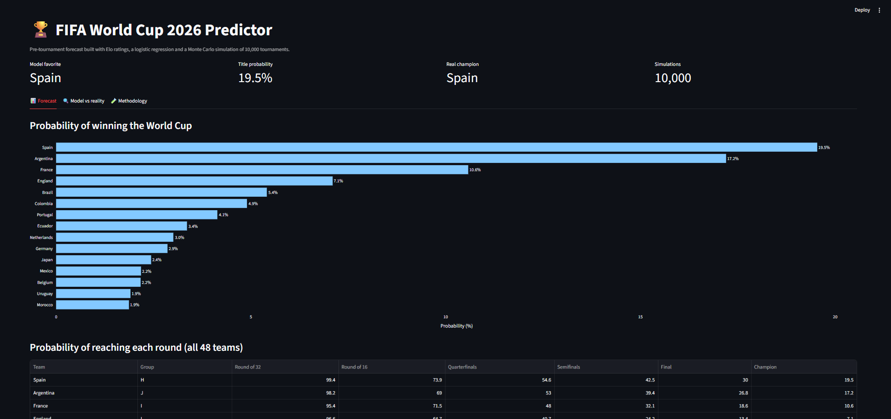

# FIFA World Cup 2026 Predictor

Elo ratings + logistic regression + Monte Carlo simulation of the 48-team World Cup, validated against the real tournament.



## Results

The forecast uses only information available **before kickoff (June 11, 2026)**. The code was written after the tournament, so this is a backtest, not a live forecast.

**Title odds (10,000 simulated tournaments) vs what happened**

| Team | Model title odds | Real result |
|---|---|---|
| Spain | 19.5% | Champion |
| Argentina | 17.2% | Runner-up |
| France | 10.6% | 4th place |
| England | 7.1% | 3rd place |

The four most likely champions according to the model were the four real semifinalists. One tournament is a single sample, though: a ~20% favorite is expected to win about 1 time in 5.

**Match-level validation** (lower log loss is better)

| Test set | Model | Baseline (historical frequencies) |
|---|---|---|
| 541 competitive matches of 2022 | 0.932 | 1.049 |
| 90 matches of the 2026 World Cup (until July 4) | 0.850 | 1.049 |

On the 2026 matches, accuracy is 66.7% vs 64.4% for "the team with the higher Elo wins". That difference is 2 matches out of 90, so the gain comes from better probabilities, not from picking more winners. On the 2018 and 2022 World Cups (64 matches each) the differences between models are within noise.

## How it works

1. **Elo ratings** are computed from scratch from ~49,000 international results (1872-2026). The rating used for each match is the one *before* it was played, so there is no temporal leakage.
2. **Model:** logistic regression on the rating difference and neutral venue, trained on ~32,000 matches since 1990. Richer variants (recent form, gradient boosting) were tested and did not improve results, so the simple model was kept.
3. **Simulation:** 12 groups, top 2 plus the 8 best third-placed teams, the official round-of-32 bracket and FIFA's third-place assignment table (Annex C of the regulations).

## Run it

```bash
pip install -r requirements.txt

python src/build_historical_training_dataset.py   # Elo + features -> training set
python src/train_model.py                         # final model + pre-tournament ratings
python src/evaluate_wc2026.py                     # model vs real 2026 matches
python src/simulate.py                            # 10,000 simulated tournaments
streamlit run dashboard/app.py                    # interactive dashboard
```

`python src/train_baseline.py` reproduces the model comparison on temporal exams.

## Project structure

```
dashboard/app.py          Streamlit dashboard
data/raw/                 source results + FIFA third-place table
data/processed/           clean results, groups, ratings, simulation outputs
models/                   trained model
notebooks/                data preparation of the results dataset
src/
  elo.py                  Elo ratings (pre-match)
  features.py             rolling form features (tested, not used in the final model)
  build_historical_training_dataset.py
  train_baseline.py       baselines + model comparison, temporal splits
  train_model.py          final model + pre-tournament ratings
  predict.py              match probabilities
  bracket.py              official 2026 bracket and third-place table
  simulate.py             Monte Carlo simulation
  evaluate_wc2026.py      validation against real matches
```

## Assumptions and limitations

- Tie-breakers in groups and among third-placed teams are random (the model predicts outcomes, not goals).
- Knockout draws are resolved 50/50 (extra time and penalties).
- Host advantage applies only in the group stage.
- Ratings are not updated during the tournament; injuries and squads are not modelled.
- Real-vs-forecast comparison uses the matches present in the dataset (until July 4, 2026).

## Data and credits

Match results: [International football results](https://github.com/martj42/international_results) by Mart Jürisoo. Third-place assignment table: FIFA World Cup 2026 Regulations, Annex C. Real tournament results: Wikipedia.